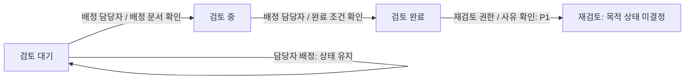

# 유스케이스·업무 흐름 명세서

> 상태: 검토용 초안 · 개정일: 2026-11-16
> 기준: [기능 명세서](functional-specification.md). 아래 업무 주체는 역할 설명이며 확정된 역할 코드가 아니다.

## 1. 업무 주체와 접근 범위

| 주체 | 주요 작업 | 결정 사항 |
|---|---|---|
| 로그인 사용자 | 로그인·로그아웃·본인 정보 | 인증 수단·계정 연결·조회 항목 |
| 등록·관리 주체 | 케이스·영상 등록·수정·삭제/보관·배정 | 허용 역할·과/담당/전체 범위 |
| 처리 주체 | 뷰어·ROI·알고리즘 실행·결과 저장 | 수행 자격·상태별 허용 |
| 검토 주체 | 시작·메모·리포트·완료·재검토 | 담당자·대리 검토·완료 조건 |
| 권한 관리 주체 | 사용자 역할 변경 | 실제 관리자 역할·자기 변경 여부 |
| 현황 조회 주체 | 집계·기록 조회 | 전체·과·본인 담당 범위 |

최소 2개 이상 서로 다른 권한 유형이 필요하다. 실제 RBAC 행렬은 AUTH-05·06과 D-01에서 확정한다. 같은 과이거나 담당자로 연결되었다는 사실만으로 모든 기능을 허용하지 않는다. 미결정 권한을 자동 허용하지 않는다.

## 2. 유스케이스

모든 보호 기능은 인증 신원·기능 권한·대상 데이터 범위를 검증한다.

| ID | 목표·사전 조건 | 정상 흐름 | 예외 및 결과 | 기능 연결 |
|---|---|---|---|---|
| UC-01 | 인증·허용 범위 접근; 계정 연결 필요 | 로그인→사용자 식별→허용 정보 조회→로그아웃 | 인증·권한 실패 시 보호 접근 거절 | AUTH-01~06 |
| UC-02 | 케이스·파일 관리; 등록·조회 권한 | 모의 환자/과 선택→케이스 등록→파일 검증·저장→검색·재조회 | 잘못된 참조·파일·저장 실패 안내. 삭제/보관은 정책 후 적용 | CASE-01~07, IMG-01~06 |
| UC-03 | 영상 분석; 접근 가능한 입력 파일 | 영상 열람→ROI 분석→처리 방법·설정 선택→실행→비교→결과 저장·재조회 | ROI·설정 검증, 실패 결과와 성공 구분, 원본 보존 | VIEW-01~08, PROC-01~09, IMG-07~08 |
| UC-04 | 배정·업무 관리; 배정/상태 권한 | 담당자 지정→대기/담당 목록→검토 시작→현재 상태 조회 | 허용되지 않은 전이·중복·동시 변경 처리 | CASE-08, REV-01~03, WORK-01~03 |
| UC-05 | 검토·기록; 검토 권한 | 메모 작성·수정→리포트→완료 또는 재검토→기록 조회 | 없는 과거 이력을 현재값으로 대체하지 않음. 부족 구조 보완 후 전체 흐름 검증 | REV-04~09, WORK-04~06 |
| UC-06 | 특화 기능; 선정 후 구체화 | 입력→기능 수행→결과→모의 업무 비교 | 입력·실패·개선 기준은 미결정 | FR-12 |

## 3. 상태전이 검토안

상태 코드는 `src/models.py`의 `CaseStatus`인 `검토 대기`, `검토 중`, `검토 완료` 3개로 확정되었다(2026-11-19, DB 설계서 v1.3). 담당자 배정은 상태값이 아니라 `case_assignees`의 배정 문서로 표현하며, 검토 시작의 사전 조건이다. 실행 주체와 세부 조건은 아래 제안을 기준으로 검토 모듈에서 확정한다.

| 전이 | 실행 주체 제안 | 조건·확인할 정책 |
|---|---|---|
| (등록)→검토 대기 | 케이스 등록 권한 보유자 | 등록 시 초기 상태 |
| 검토 대기 상태에서 담당자 배정 | 배정 권한 보유자 | 유효한 담당자, 상태값은 변경하지 않음 |
| 검토 대기→검토 중 | 해당 케이스의 배정 담당자 | 담당자 배정 문서 존재, 검토 시작 기록 여부 |
| 검토 중→검토 완료 | 해당 케이스의 배정 담당자 | 필수 메모·리포트·결과와 완료 기록 |
| 검토 완료→재검토 | 재검토 권한 보유자 (P1) | 요청 사유·담당자·목적 상태·수정 범위 |

## 4. 공통 예외와 기록

- 다른 케이스의 환자·파일·실행·담당 관계를 잘못 연결하는 요청을 거절한다.
- 상태 변경 직전 현재 상태와 권한을 다시 확인하고, 중복 클릭·동시 수정의 충돌 처리 정책을 확정한다.
- 파일/DB 저장이 모두 확인되기 전 성공을 표시하지 않는다. 재시도·정리 정책은 미결정이다.
- 등록자·수행자는 검증된 인증 신원에서 정한다. 케이스 수정 시각을 검토 시작·완료 시각으로 대신하지 않는다.
- 메모 현재값과 리포트·변경 이력은 구분한다. 현재 8개 데이터 구조의 부족분은 설계서에서 명시한다.

## 5. 검증 연결

기능별 인수 기준 및 기능 명세서 AC-01~15를 사용한다. 역할별 허용·거부, 다른 과·미배정 케이스, 허용되지 않은 전이, 동시 수정, 저장 실패, 재시작 후 재조회를 포함한다. 미결정 정책에 의존하는 테스트는 정책 확정 후 통과 여부를 판정한다.
